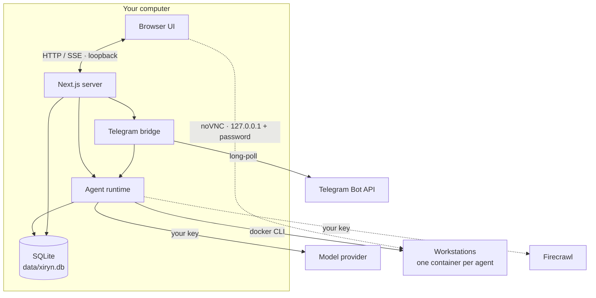

# Architecture

Xiryn is one Node.js process — a Next.js 16 server — plus a SQLite file. There is no queue, no worker, no separate backend and nothing of ours in the cloud. This page explains how the pieces fit.

## Request flow of a turn

1. The composer posts the new message to `POST /api/threads/:id/turn`.
2. `lib/agent/runtime.ts` loads the thread (agent or squad), resolves the model (`lib/providers/registry.ts`), saves the user message, and builds the tool belt for the configured capabilities.
3. Instructions are assembled per agent (`lib/agent/instructions.ts`): identity, standing orders, capabilities, **memory notes**, squad roster and channel.
4. `streamText` runs the tool loop. The last allowed step is offered no actions, so a long task still ends with an answer. If the model stops with no visible text and no tool call (small models sometimes end on their reasoning alone), one more call, tools off, asks for the reply; it streams on as part of the same message. The output becomes a UI message stream that is **buffered in a run object** and fanned out to any number of subscribers.
5. When the stream ends the reply is persisted, the thread preview updated and a row written to the `turns` ledger.

Because the run lives in the server process and not in the HTTP request, closing the tab doesn't stop it. `GET /api/threads/:id/turn` replays the buffer and follows it live — that's how a reload re-attaches. `DELETE` aborts it.

## Tools

Defined in `lib/agent/tools.ts`. Every tool resolves "the agent holding the turn" at call time, so after a delegation the same tool acts on the new agent's workstation and memory.

| Group | Tools | Backed by |
| --- | --- | --- |
| Workstation | `shell`, `fs_read`, `fs_write`, `fs_list` | `docker exec` into the agent's container |
| Desktop | `screen_capture`, `screen_share`, `pointer_*`, `key_*` | `scrot` and `xdotool` on the container's X display |
| Memory | `memory_write`, `memory_forget` | Local SQLite |
| Routines | `routine_create`, `routine_list`, `routine_delete` | Local SQLite; run by the scheduler (not offered during a routine's own runs) |
| Web | `web_search`, `web_fetch` | Firecrawl v2 |
| Squad | `delegate` | Runtime (swaps agent, instructions and model) |
| Hand-off | `request_takeover` | Runtime (ends the turn) + Telegram notice |

Screenshots are returned to the model as images. OpenAI, Anthropic, Gemini, xAI, DeepSeek and Ollama take images inside tool results; for other providers (OpenAI-style APIs such as OpenRouter, LM Studio, Groq, Mistral or a custom endpoint, which would turn them into base64 text) the tool result keeps only its caption and the image follows in a message of its own, after a one-line assistant turn because Mistral and many chat templates refuse a user turn right after a tool turn. Before every step, `prepareStep` compacts the turn's context: only the two most recent screenshots and the six most recent tool outputs are kept in full, older ones are cut to short stubs. A long desktop session therefore costs roughly the same per step at step 40 as at step 4.

## Take-over and hand-offs

Either side can hand the desktop over.

- **You take over.** The workbench's *Take over* button stops a running turn (the same `DELETE` as *Stop*) and opens the desktop full-size with input enabled. *Hand back* sends an ordinary user message carrying `metadata.handback` with your optional note; the transcript renders it as a divider, and the instructions tell the agent to take a fresh `screen_capture` before doing anything else, since the screen may have changed.
- **The agent hands off.** At a login, payment, one-time code or CAPTCHA the agent calls `request_takeover({ reason })`. `stopWhen` includes `hasToolCall("request_takeover")`, so the turn ends right there. The UI sees the fresh tool call and opens the take-over view; if Telegram is paired, `notifyTakeover` sends the owner the reason, a 30-minute link to that desktop through a Cloudflare quick tunnel (usable from a phone) and a deep link to `/a/:agent/:thread?takeover=1`, and points the chat at that thread so the reply continues it.

## The vault

`lib/vault.ts` stores logins, cards, UPI IDs and personal details in `vault_items`, each sealed with AES-256-GCM (the item's id and kind are bound in as associated data). The key comes from the operating system's keychain — `security` on macOS, DPAPI through PowerShell on Windows, `secret-tool` on Linux — or a `0600` file outside the data folder, and is never recreated while items exist. Agents get four tools:

| Tool | Does |
| --- | --- |
| `vault_list` | Labels and masked hints, never values |
| `vault_fill` | Types one field into the focused input: from stdin through `xdotool`, then `xiryn-mask` shows it as dots. Checks the page's site through Chromium's debugging port first: a login only on its own site, a card or UPI ID only with an approval for this thread and site |
| `request_payment_approval` | Records a pending payment (merchant, amount, site) and ends the turn. The person approves with a saved method, takes over, or declines — in the transcript card or with Telegram buttons |
| `request_secret` | Ends the turn with a secure form for a login, card, UPI ID, personal details or a code. What's entered goes straight into the vault; the agent receives the new item's id. On Telegram, a requested code can be replied with; the message is deleted and the code stored once |

Answers continue the thread as ordinary messages that carry ids and hints only (`lib/vault-requests.ts`).

## Notifications

The runtime emits an event when a turn finishes (or fails) and when an agent hands over its screen (`lib/events.ts`). The browser follows them over a server-sent event stream at `/api/events`: the notifier plays a short synthesized chime and shows a desktop notification when Xiryn isn't the window in focus, or a toast when you're elsewhere in the app. A finished turn that started in the app is also sent to the paired Telegram account when it took a minute or more (`XIRYN_TELEGRAM_NOTIFY`); a routine's runs are sent however short. When no tab is listening — Xiryn running with `npm run background`, say — `lib/desktop-notify.ts` asks the operating system to show the notification instead (a toast through PowerShell on Windows, `osascript` on macOS, `notify-send` on Linux), passing the text as arguments or environment, never through a shell (`XIRYN_DESKTOP_NOTIFY`).

## Routines

A routine (`routines` table) is a prompt, an owner (an agent or a squad) and a schedule — daily, weekdays, weekly, every few hours, or once — in the server's local time. `lib/routines.ts` is started from `instrumentation.ts` and checks every 30 seconds for routines that are due. Each run moves `next_run_at` on first (so a failed run never repeats; a one-off switches itself off), then sends the prompt into the routine's own thread through `startTurn` with `routine` set: the message carries `metadata.routine`, the instructions tell the agent nobody is watching, and the routine tools are left out so a run can't schedule more runs. A run missed by up to six hours (the computer slept) still happens; older ones are skipped until the next time. If the thread is busy, it tries again in five minutes. Every time a routine comes due or is run by hand gets a row in `routine_runs` — started, skipped (missed, or busy) or failed to start — closed with its outcome when the run ends. A run's turn is recorded in the `turns` ledger under the run's own id, which `routine_runs.turn_id` points to, so the history's costs are the ledger's. Runs still open when Xiryn starts are closed as interrupted.

`scripts/background.mjs` keeps the server running with no terminal: it builds once per version or commit, starts `next start` detached on 127.0.0.1, records the pid in `data/background.pid` and logs to `data/xiryn.log`. `login` adds an entry the operating system starts at login (a hidden `.vbs` in the Windows Startup folder, a LaunchAgent on macOS, an XDG autostart entry on Linux).

## Local models

`lib/ollama.ts` talks only to the Ollama endpoint configured for Xiryn (`/api/version`, `/api/tags`, `/api/pull`). Settings → Local models starts a pull, which streams progress as lines of JSON into an in-memory map the panel polls. Downloading or choosing a model points Xiryn at Ollama if nothing else does; `npm run setup:local` does the same from the terminal, installing Ollama first if needed. Turns on Ollama models go through its native `/api/chat` (`ai-sdk-ollama`), with `num_ctx` (32K, 16K under 12 GB of memory) and `keep_alive` on every request: Ollama's default context is often 4K, which would cut an agent's prompt. Reasoning from earlier steps is left out of what's sent back (Ollama would fold it into the reply text), and a call that has to answer rather than act is offered no tools, since Ollama's API has no tool choice.

## Squads and delegation

A squad thread has an ordered list of members. A message is addressed to one of them. When that agent calls `delegate`, the tool switches the runtime's *current agent*; `prepareStep` then swaps the system instructions and the **model** for the next step, so each member thinks with its own model and works on its own workstation. The receiving agent is told who handed over and with what brief. A request can't bounce back to an agent that already held it.

## Workstations

Each agent's workstation is a Docker container named `xiryn-ws-<agent id>`, run from an image built on your computer out of [`workstation/`](../workstation): Debian with Xvfb, xfwm4 and a panel, Chromium, x11vnc + noVNC, xdotool, Node.js, Python and passwordless `sudo`. Xiryn talks to Docker only through the `docker` CLI (`lib/docker.ts`), so Docker Desktop, Docker Engine, Colima or OrbStack all work, as does whatever context the CLI points at.

- **Image.** Its tag is a fingerprint of the `workstation/` folder (`lib/workstation-image.ts`). `npm run setup` builds it, or Xiryn does at boot or on first use. When an update changes the folder, the new image is built once and each agent moves to it the next time its machine starts.
- **Lifecycle.** The first tool call that needs a machine creates it (starting Docker Desktop if it isn't running), with the agent's home folder in a named volume, `xiryn-home-<agent id>`, so files survive restarts and image updates. Inside the container a watchdog stops it after `XIRYN_WORKSTATION_AUTO_STOP_MINUTES` without activity (a running command or someone watching counts), even if Xiryn itself is closed. A janitor in the server removes machines of deleted agents and, with `XIRYN_WORKSTATION_AUTO_DELETE_MINUTES`, machines stopped for longer than that. Resetting or deleting an agent removes its container and volume.
- **Commands.** `shell` runs `xiryn-run`, which writes output to a file, so a program left running in the background can't hold the call open, and returns the beginning and end of very long output.
- **Live desktop.** noVNC listens on port 6080 inside the container, published on `127.0.0.1` with a random host port. The browser connects there directly with the container's random VNC password, which only the server hands out. For phone take-overs, `xiryn-tunnel` starts a Cloudflare quick tunnel inside the container that closes itself after 30 minutes.

## Data

Everything lives in `data/xiryn.db` (override with `XIRYN_DATA_DIR`). Schema: `db/schema.ts`; migrations in `db/migrations` run automatically at boot.

| Table | Holds |
| --- | --- |
| `agents` | Name, role, standing orders, model, glyph seed, workstation id |
| `squads`, `squad_members` | Squads and their ordered members |
| `threads`, `messages` | Conversations and their UI messages (JSON parts) |
| `memories` | Long-term notes per agent |
| `turns` | The usage ledger, with each turn's cost in millionths of a dollar |
| `routines` | Scheduled tasks: prompt, owner, schedule, next and last run |
| `routine_runs` | Each time a routine came due or was run by hand: outcome, reason, timing and its turn |
| `settings` | Values saved from Settings (override `.env`) |

## Settings resolution

`lib/config.ts` defines every setting once, with its environment variable and default. A value saved in the UI wins over `.env`, which wins over the default. Secrets are only ever described to the browser in masked form.

## Telegram bridge

`lib/telegram/bridge.ts` long-polls `getUpdates` from inside the server process — no inbound connection is needed. Updates are processed per chat in order. Unpaired users get a refusal; the owner's messages start turns through the same runtime with `channel: "telegram"`, progress is reported by editing one status message, and the final reply (including shared screenshots as photos) is sent when the run ends. Threads started from Telegram are ordinary threads in the app.

## Security boundary

`proxy.ts` runs before every request and refuses any `Host` that isn't loopback (or in `XIRYN_ALLOWED_HOSTS`), and any `Origin` that doesn't match the `Host`. Together with binding to `127.0.0.1`, this keeps an account-less app private from browsers and blocks DNS rebinding; it is not authentication, and a client that sets its own headers is not stopped by it. See [SECURITY.md](../SECURITY.md) and the [October 2026 audit](security-audit-2026-10.md) for what that means in practice.
